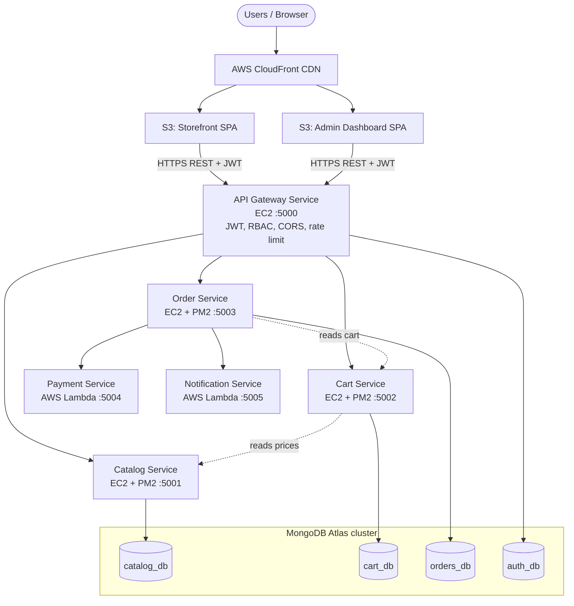
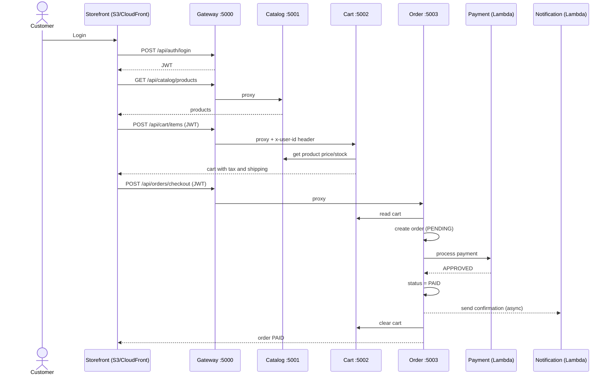
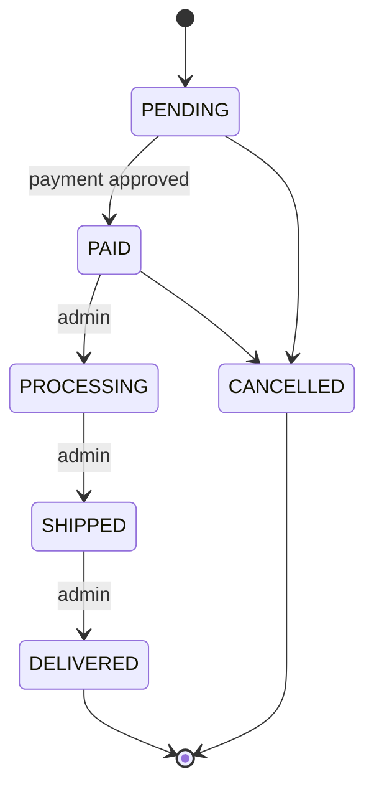

# ShopiTry Architecture

GitHub renders the Mermaid diagrams below automatically. A static image version is in `docs/architecture.svg` / `architecture.png`.

## 1. System architecture

## 2. Checkout sequence

## 3. Order state machine

## 4. Security model
- The gateway verifies the JWT, then forwards identity to services as `x-user-id`, `x-user-role`, `x-user-email` headers. Incoming headers with those names are stripped first, so clients cannot spoof them.
- Catalog reads are public; writes need role `admin`. Order stats and status changes need `admin` (checked at the gateway and again in the order service).
- Payment and notification services are not routed through the gateway. Only the order service calls them.
- In AWS, put services 2-4 in a private subnet and allow inbound only from the gateway's security group.
